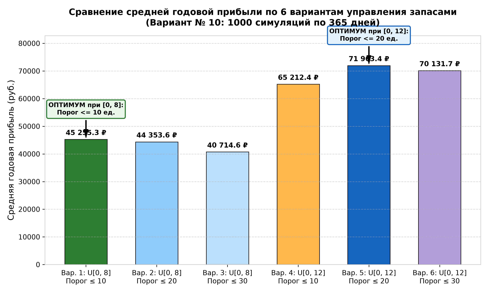
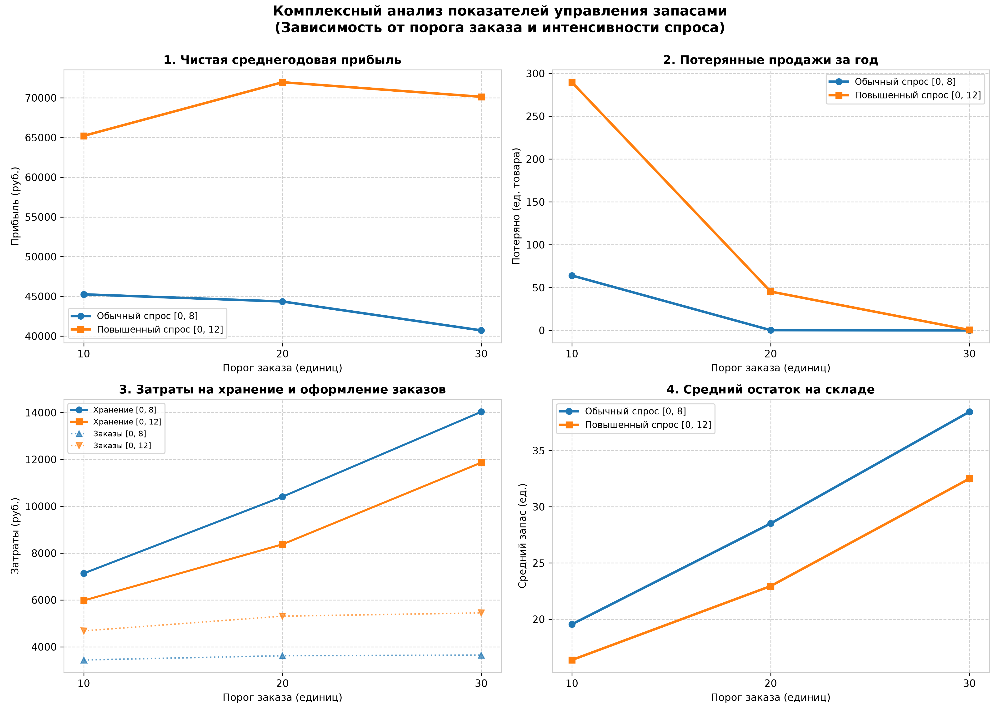

# Курсовая работа: Вариант № 10
## Исследование способов пополнения товарных запасов магазина

Репозиторий совместного группового проекта по дисциплине «Моделирование систем» (3 семестр).

### Команда проекта
* **Ева (Eva)** — математическая постановка задачи, базовая модель склада и контрольный пример.
* **Крис (Chris)** — имитационное моделирование методом Монте-Карло, синхронизация спроса (CRN).
* **Вова (Vova, view321)** — консольный интерфейс, форматированные таблицы, визуализация и автоматизация сборки.
* **Сергей (Sergey)** — экономический анализ, модуль графиков, экспорт данных и академический отчёт.

---

### 1. Постановка задачи и формализация модели
В работе исследуется функционирование розничного магазина с одним видом товара в условиях стохастического покупательского спроса. Требуется исследовать пороговые правила пополнения запасов и определить стратегию, максимизирующую годовую прибыль.

#### Параметры модели:
* **Горизонт моделирования**: 365 дней (1 календарный год).
* **Начальный запас**: 40 единиц на начало первого дня.
* **Размер партии пополнения**: фиксированный объем 40 единиц.
* **Срок доставки (Lead Time)**: 3 календарных дня (заказ вечером дня $t$ прибывает утром дня $t+3$).
* **Ограничение на заказы в пути**: пока предыдущий заказ находится в пути, новый заказ оформлять запрещено.
* **Ограничение горизонта**: после 362-го дня новые заказы не оформляются.
* **Экономические показатели**:
  * Доход от продажи: 40 руб./ед. (после вычета закупочной себестоимости).
  * Стоимость оформления заказа: 100 руб./заказ.
  * Стоимость суточного хранения: 1 руб./ед. в конце дня.
* **Исследуемые уровни спроса**:
  1. Обычный спрос: дискретное равномерное $U[0, 8]$ ед./день ($E[D] = 4.0$ ед./день).
  2. Повышенный спрос: дискретное равномерное $U[0, 12]$ ед./день ($E[D] = 6.0$ ед./день).
* **Пороговые значения остатка для заказа**: $\le 10$, $\le 20$, $\le 30$ единиц.

---

### 2. Исследовательская часть

#### 2.1. Контрольный пример с расчётом по дням
Для верификации корректности модели проведён 10-дневный детерминированный прогон (порог $\le 20$ ед., $Q=40$ ед., Lead Time = 3 дня, начальный запас 40 ед., спрос: $D = [8, 14, 10, 12, 5, 12, 8, 11, 6, 7]$):

| День | Дост. | Склад утро | Спрос | Прод. | Потери | Остаток | Хран. (руб) | Заказ (руб) | Прибыль дня | Накопл. | События и статус заказа |
|:---:|:---:|:---:|:---:|:---:|:---:|:---:|:---:|:---:|:---:|:---:|:---|
| **1** | 0 | 40 | 8 | 8 | 0 | 32 | 32 | 0 | +288 | +288 | Остаток 32 > 20, заказ не нужен |
| **2** | 0 | 32 | 14 | 14 | 0 | 18 | 18 | 100 | +442 | +730 | Остаток 18 ≤ 20 → Заказ #1 (приход утром дня 5) |
| **3** | 0 | 18 | 10 | 10 | 0 | 8 | 8 | 0 | +392 | +1122 | Остаток 8 ≤ 20, но заказ #1 уже в пути (блокировка) |
| **4** | 0 | 8 | 12 | 8 | 4 | 0 | 0 | 0 | +320 | +1442 | Дефицит! Продано 8 из 12 (4 потери). Хранение = 0 |
| **5** | +40 | 40 | 5 | 5 | 0 | 35 | 35 | 0 | +165 | +1607 | Принят Заказ #1 (ровно 3 дня!). Флаг пути снят |
| **6** | 0 | 35 | 12 | 12 | 0 | 23 | 23 | 0 | +457 | +2064 | Остаток 23 > 20, заказ не нужен |
| **7** | 0 | 23 | 8 | 8 | 0 | 15 | 15 | 100 | +205 | +2269 | Остаток 15 ≤ 20 → Заказ #2 (приход утром дня 10) |
| **8** | 0 | 15 | 11 | 11 | 0 | 4 | 4 | 0 | +436 | +2705 | Заказ #2 в пути, повторный заказ заблокирован |
| **9** | 0 | 4 | 6 | 4 | 2 | 0 | 0 | 0 | +160 | +2865 | Дефицит! Продано 4 из 6 (2 потери). Хранение = 0 |
| **10** | +40 | 40 | 7 | 7 | 0 | 33 | 33 | 0 | +247 | +3112 | Принят Заказ #2 (ровно 3 дня!). Склад пополнен |

**Посуточный расчёт и балансовая верификация:**
* Выручка: $87 \times 40 = 3\,480$ руб.
* Затраты на заказы: 2 заказа (дни 2 и 7) $\times 100 = 200$ руб.
* Затраты на хранение: 168 руб.
* **Итоговая чистая прибыль:** $3\,480 - 200 - 168 = \mathbf{3\,112\text{ руб.}}$
* Сумма прибылей по дням ($288+442+392+320+165+457+205+436+160+247 = 3\,112$ руб.) подтверждает 100% точность алгоритма.
* Доказано строгое соблюдение срока поставки (ровно 3 дня) и блокировка заказов во время нахождения партии в пути.

---

#### 2.2. Таблица результатов для шести вариантов входных данных
Статистическое моделирование выполнено методом Монте-Карло ($N = 1000$ годичных прогонов по 365 дней) с использованием метода парных случайных чисел (CRN):

| № вар. | Уровень спроса | Порог заказа | Средняя прибыль (руб.) | Потерянные продажи (ед.) | Средний остаток (ед.) | Число заказов | Fill Rate (%) | Выручка (руб.) | Затраты: заказы | Затраты: хранение |
|:---:|:---|:---:|:---:|:---:|:---:|:---:|:---:|:---:|:---:|:---:|
| **1** | **Обычный спрос** $U[0, 8]$ | $\le 10$ ед. | **45 255.27** | 64.08 | 19.55 | 34.39 | 95.62% | 55 829.7 | 3 438.7 | 7 135.7 |
| **2** | **Обычный спрос** $U[0, 8]$ | $\le 20$ ед. | 44 353.58 | 0.26 | 28.52 | 36.21 | 99.98% | 58 382.3 | 3 620.7 | 10 408.0 |
| **3** | **Обычный спрос** $U[0, 8]$ | $\le 30$ ед. | 40 714.62 | 0.00 | 38.44 | 36.46 | 100.00% | 58 392.8 | 3 646.3 | 14 031.9 |
| **4** | **Повышенный спрос** $U[0, 12]$ | $\le 10$ ед. | 65 212.43 | 289.75 | 16.38 | 46.82 | 86.77% | 75 871.0 | 4 681.7 | 5 976.9 |
| **5** | **Повышенный спрос** $U[0, 12]$ | $\le 20$ ед. | **71 963.39** | 45.31 | 22.95 | 53.10 | 97.94% | 85 648.4 | 5 309.7 | 8 375.3 |
| **6** | **Повышенный спрос** $U[0, 12]$ | $\le 30$ ед. | 70 131.72 | 0.48 | 32.50 | 54.47 | 99.98% | 87 441.6 | 5 446.9 | 11 862.9 |

---

#### 2.3. Показатели по каждому варианту: средняя прибыль, потерянные продажи, средний остаток
* **Вариант 1 (Спрос $U[0, 8]$, Порог $\le 10$):** Средняя прибыль **45 255.27 руб./год**, потери **64.08 ед.**, средний остаток **19.55 ед.** — **ОПТИМУМ** при обычном спросе (минимизация складских затрат).
* **Вариант 2 (Спрос $U[0, 8]$, Порог $\le 20$):** Средняя прибыль **44 353.58 руб./год**, потери **0.26 ед.**, средний остаток **28.52 ед.** — избыточный запас (переплата за хранение превышает спасение продаж).
* **Вариант 3 (Спрос $U[0, 8]$, Порог $\le 30$):** Средняя прибыль **40 714.62 руб./год**, потери **0.00 ед.**, средний остаток **38.44 ед.** — затоваривание склада (потеря 4 541 руб. прибыли относительно оптимума).
* **Вариант 4 (Спрос $U[0, 12]$, Порог $\le 10$):** Средняя прибыль **65 212.43 руб./год**, потери **289.75 ед.**, средний остаток **16.38 ед.** — критический дефицит (потери ~290 продаж или 11 590 руб. маржи).
* **Вариант 5 (Спрос $U[0, 12]$, Порог $\le 20$):** Средняя прибыль **71 963.39 руб./год**, потери **45.31 ед.**, средний остаток **22.95 ед.** — **ОПТИМУМ** при повышенном спросе (+6 751 руб. к варианту 4 за счёт страхового буфера).
* **Вариант 6 (Спрос $U[0, 12]$, Порог $\le 30$):** Средняя прибыль **70 131.72 руб./год**, потери **0.48 ед.**, средний остаток **32.50 ед.** — избыточный запас (рост хранения на 3.5 тыс. руб. снижает прибыль).

---

#### 2.4. Диаграмма по сравнению прибыли всех 6 вариантов

*Рис. 1. Сравнение средней годовой чистой прибыли по всем 6 вариантам входных данных*

*Рис. 2. Комплексный анализ компромисса: чистая прибыль, потерянные продажи, затраты на хранение и средний остаток*

---

#### 2.5. Сравнение порогов в зависимости от спроса
| Показатель | $U[0, 8]$: шаг 10→20 | $U[0, 8]$: шаг 20→30 | $U[0, 12]$: шаг 10→20 | $U[0, 12]$: шаг 20→30 | Экономическая интерпретация |
|:---|:---:|:---:|:---:|:---:|:---|
| **$\Delta$ Прибыли (руб.)** | -901.7 ₽ | -3 639.0 ₽ | **+6 751.0 ₽ (Оптимум!)** | -1 831.7 ₽ | При $U[0,8]$ оптимум 10, при $U[0,12]$ оптимум 20 |
| **$\Delta$ Потерь продаж** | -63.82 ед. | -0.26 ед. | **-244.43 ед. (-84%)** | -44.83 ед. | Порог 20 надежно купирует дефицит при высоком спросе |
| **$\Delta$ Затрат на хранение** | +3 272.3 ₽ | +3 623.9 ₽ | +2 398.4 ₽ | +3 487.6 ₽ | Затраты на хранение растут монотонно и опережающе |
| **$\Delta$ Выручки (маржи)** | +2 552.6 ₽ | +10.5 ₽ | **+9 777.4 ₽** | +1 793.2 ₽ | Спасение маржи окупает хранение только при $U[0,12]$ |

---

#### 2.6. Пояснение и выводы из сравнения порогов
1. **Ожидаемый спрос за время доставки (Lead Time Demand, 3 дня):**
   * При $U[0, 8]$: $E[D_{LT}] = 3 \times 4.0 = 12$ ед. Порог 10 близок к расходу за время доставки; редкие потери (64 ед. или 2 563 руб.) с лихвой окупаются экономией на хранении (3 272 руб.).
   * При $U[0, 12]$: $E[D_{LT}] = 3 \times 6.0 = 18$ ед. Порог 10 намного ниже среднего расхода ($10 < 18$). Склад гарантированно опустошается. Порог 20 создает надежный буфер ($20 > 18$), спасая 244 продажи и принося +6 751 руб. чистой прибыли.
2. **Асимметрия затрат ($40 : 1$):**
   * Маржа продажи 1 ед. = 40 руб., суточное хранение = 1 руб.
   * Потеря 1 продажи эквивалентна 40 суткам хранения. При систематическом дефиците экономия на хранении губительна.
3. **Закон убывающей предельной отдачи (порог 30):**
   * Ликвидация последних долей процента дефицита требует содержания огромного склада (32–38 ед.). Затраты на хранение резко превышают выручку, делая порог 30 убыточным при любом спросе.

---

#### 2.7. Общий вывод
1. **Оптимальный порог не универсален:** точка заказа жестко зависит от интенсивности спроса.
2. **При обычном спросе ($U[0, 8]$)** оптимален **порог $\le 10$ ед.** (среднегодовая прибыль **45 255.27 руб.**).
3. **При повышенном спросе ($U[0, 12]$)** оптимален **порог $\le 20$ ед.** (среднегодовая прибыль **71 963.39 руб.**).
4. **Порог $\le 30$ ед.** экономически нецелесообразен ни при каких условиях.
5. **Рекомендация менеджменту:** переход на адаптивное пороговое управление (порог 10 в обычные периоды, порог 20 в высокий сезон).
6. **Метод Монте-Карло с CRN** подтвердил точность и наглядно вскрыл баланс компромисса «дефицит — хранение».

---

### 3. Сборка и запуск проекта

#### Сборка:
* **Windows**: `build.bat` (или `g++ -O3 -std=c++17 main.cpp -o store_sim.exe`).
* **Linux / macOS**: `make` (с использованием `Makefile`).

#### Запуск:
* **Windows**: `run.bat` или прямой вызов `.\store_sim.exe`.
* **Linux / macOS**: `./store_sim.exe`.

#### Аргументы командной строки:
* `--demo` — запуск пошаговой валидации контрольного примера (10 дней).
* `--sim` — запуск только статистической симуляции Монте-Карло.
* `--experiments <N>` — число годичных прогонов (по умолчанию 1000).
* `--seed <N>` — фиксация начального значения ГСЧ (по умолчанию 12345).

Подробный академический отчёт доступен в файле [REPORT_VARIANT_10.docx](REPORT_VARIANT_10.docx) и [REPORT_VARIANT_10.md](REPORT_VARIANT_10.md).
