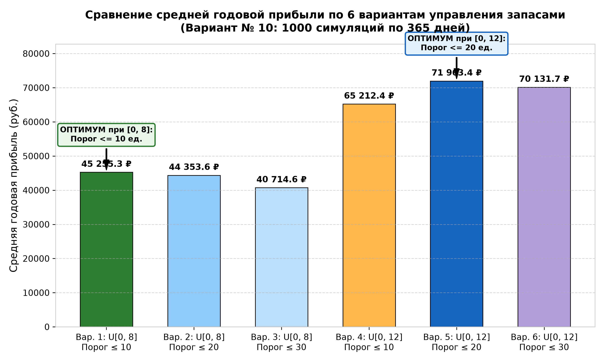
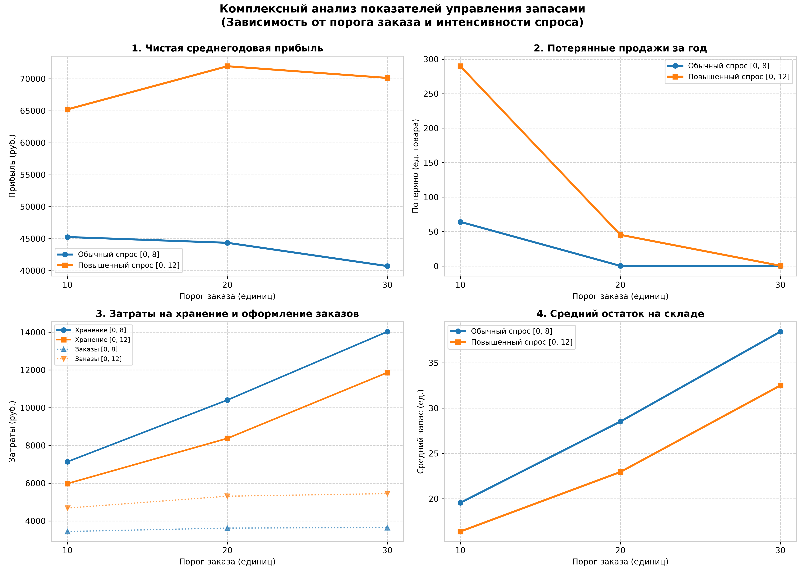

# Отчёт по курсовой работе
## Дисциплина: «Моделирование систем» (3 семестр)
### Тема: «Исследование способов пополнения товарных запасов магазина» (Вариант № 10)

**Состав студенческой бригады:**
* **Ева (Eva)** — математическая формализация, базовая модель склада и контрольный пример
* **Крис (Chris)** — имитационное моделирование методом Монте-Карло, синхронизация спроса (CRN)
* **Вова (Vova, view321)** — автоматизация сборки, консольный интерфейс, расчёт показателей и визуализация
* **Сергей (Sergey)** — экономический анализ, модуль генерации графиков, экспорт данных и аналитический отчёт

---

## 1. Постановка задачи и формализация модели

### 1.1. Описание исследуемой системы
В курсовой работе исследуется функционирование розничного торгового предприятия (магазина), реализующего один вид штучного товара в условиях случайного ежедневного покупательского спроса. Для обеспечения непрерывности торгового процесса и максимизации итоговой прибыли предприятию необходимо поддерживать рациональный уровень складских запасов:
* **Слишком поздний заказ:** приводит к дефициту товара на складе, возникновению неудовлетворенного спроса и прямым финансовым потерям маржинального дохода от упущенных продаж.
* **Слишком ранний заказ:** приводит к затовариванию склада, отвлечению оборотных средств и резкому опережающему росту издержек на складское хранение.

**Цель работы** — с помощью имитационного моделирования исследовать пороговые правила пополнения запасов при различных режимах интенсивности покупательского спроса, сформировать полную таблицу результатов для всех 6 вариантов входных данных, построить сравнительные диаграммы прибыли и обосновать экономически наилучшую стратегию управления запасами.

### 1.2. Параметры модели и регламент суточного цикла
* **Горизонт моделирования:** 365 календарных дней (1 модельный год).
* **Начальный запас:** на начало 1-го дня на складе находится $S_0 = 40$ единиц товара.
* **Размер партии заказа:** фиксированный объем $Q = 40$ единиц.
* **Срок поставки:** ровно 3 календарных дня (Lead Time = 3 дня). Заказ, оформленный вечером дня $t$, поступает на склад утром дня $t + 3$.
* **Ограничение на заказы в пути:** пока предыдущий заказ находится в пути, новый заказ оформлять запрещено (одноканальная цепочка поставок).
* **Ограничение горизонта заказов:** чтобы исключить начисление затрат на поставки, приходящие за пределами моделируемого года, после 362-го дня новые заказы не оформляются.

#### Суточный регламент событий:
1. **Утро (приём поставки):** если наступил день прибытия ранее оформленного заказа, складской запас пополняется на 40 единиц ($+40$ ед.), а флаг нахождения заказа в пути сбрасывается.
2. **День (обслуживание спроса):** поступает стохастический спрос $D_t$. Фактический объем продаж составляет $V_t = \min(S_t, D_t)$. Необслуженный спрос $L_t = \max(0, D_t - S_t)$ фиксируется как безвозвратно потерянные продажи (отложенный спрос не допускается). Текущий остаток уменьшается: $S_t \leftarrow S_t - V_t$.
3. **Вечер (хранение и проверка пополнения):** на остаток товара на складе начисляется плата за суточное хранение. Затем проверяется пороговое условие: если $t \le 362$, в пути нет заказа и $S_t \le \text{Порог}$, оформляется новый заказ партии 40 ед. со списанием стоимости заказа 100 руб. и фиксацией даты прибытия $t + 3$.

### 1.3. Экономические показатели
* **Маржинальный доход от продажи:** $M = 40$ руб./ед. (выручка от реализации единицы товара за вычетом оптовой закупочной себестоимости).
* **Стоимость оформления заказа:** $K = 100$ руб. за каждую оформленную поставку (накладные транспортные и операционные расходы).
* **Стоимость складского хранения:** $h = 1.0$ руб./(ед. $\times$ день) на вечерний фактический остаток товара.
* **Итоговая годовая чистая прибыль:**
  $$\Pi = \sum_{t=1}^{365} (M \cdot V_t) - K \cdot N_{\text{orders}} - \sum_{t=1}^{365} (h \cdot S_t)$$
* **Коэффициент удовлетворения спроса (Fill Rate):**
  $$FR = \frac{\sum V_t}{\sum D_t} \times 100\%$$
* **Средний остаток товара на складе:**
  $$S_{\text{avg}} = \frac{1}{365} \sum_{t=1}^{365} S_t$$

### 1.4. Исследуемые 6 сочетаний входных данных
1. **Вариант 1:** Обычный спрос $U[0, 8]$ ед./день (матожидание 4.0 ед./день), порог заказа $\le 10$ единиц.
2. **Вариант 2:** Обычный спрос $U[0, 8]$ ед./день (матожидание 4.0 ед./день), порог заказа $\le 20$ единиц.
3. **Вариант 3:** Обычный спрос $U[0, 8]$ ед./день (матожидание 4.0 ед./день), порог заказа $\le 30$ единиц.
4. **Вариант 4:** Повышенный спрос $U[0, 12]$ ед./день (матожидание 6.0 ед./день), порог заказа $\le 10$ единиц.
5. **Вариант 5:** Повышенный спрос $U[0, 12]$ ед./день (матожидание 6.0 ед./день), порог заказа $\le 20$ единиц.
6. **Вариант 6:** Повышенный спрос $U[0, 12]$ ед./день (матожидание 6.0 ед./день), порог заказа $\le 30$ единиц.

---

## 2. Исследовательская часть

### 2.1. Контрольный пример с расчётом по дням
Для полной верификации корректности моделирования логики пополнения запасов, строгого соблюдения 3-дневного срока поставки, механизма блокировки повторных заказов во время нахождения партии в пути и правильности начисления всех затрат проведён детерминированный контрольный расчет на интервале 10 дней со следующими параметрами:
* **Параметры сценария:** Порог заказа $\le 20$ ед., партия $Q = 40$ ед., срок доставки = 3 дня, начальный запас $S_0 = 40$ ед.
* **Последовательность спроса по дням:** $D = [8, 14, 10, 12, 5, 12, 8, 11, 6, 7]$ (суммарный спрос = 93 ед.).

#### Таблица выполнения контрольного примера (дни 1–10):
| День | Дост. | Склад утро | Спрос | Прод. | Потери | Остаток | Хран. (руб) | Заказ (руб) | Прибыль дня | Накопл. | Статус и движение заказа |
|:---:|:---:|:---:|:---:|:---:|:---:|:---:|:---:|:---:|:---:|:---:|:---|
| **1** | 0 | 40 | 8 | 8 | 0 | 32 | 32 | 0 | +288 | +288 | Остаток 32 > 20, заказ не нужен |
| **2** | 0 | 32 | 14 | 14 | 0 | 18 | 18 | 100 | +442 | +730 | Остаток 18 ≤ 20 → Заказ #1 (приход утром дня 5) |
| **3** | 0 | 18 | 10 | 10 | 0 | 8 | 8 | 0 | +392 | +1122 | Остаток 8 ≤ 20, но заказ #1 уже в пути (блокировка) |
| **4** | 0 | 8 | 12 | 8 | 4 | 0 | 0 | 0 | +320 | +1442 | Дефицит! Продано 8 из 12 (4 потери). Хранение = 0 |
| **5** | +40 | 40 | 5 | 5 | 0 | 35 | 35 | 0 | +165 | +1607 | Принят Заказ #1 (ровно 3 дня!). Флаг пути снят |
| **6** | 0 | 35 | 12 | 12 | 0 | 23 | 23 | 0 | +457 | +2064 | Остаток 23 > 20, заказ не нужен |
| **7** | 0 | 23 | 8 | 8 | 0 | 15 | 15 | 100 | +205 | +2269 | Остаток 15 ≤ 20 → Заказ #2 (приход утром дня 10) |
| **8** | 0 | 15 | 11 | 11 | 0 | 4 | 4 | 0 | +436 | +2705 | Заказ #2 в пути, повторный заказ заблокирован |
| **9** | 0 | 4 | 6 | 4 | 2 | 0 | 0 | 0 | +160 | +2865 | Дефицит! Продано 4 из 6 (2 потери). Хранение = 0 |
| **10** | +40 | 40 | 7 | 7 | 0 | 33 | 33 | 0 | +247 | +3112 | Принят Заказ #2 (ровно 3 дня!). Склад пополнен |

#### Подробный пошаговый расчёт контрольного примера по дням:
* **День 1:** Начальный запас $S_1 = 40$ ед. Доставок нет. Спрос $D_1 = 8$ ед. Продажи: $V_1 = \min(40, 8) = 8$ ед. Потери: $L_1 = 0$ ед. Остаток на вечер: $S_{1,\text{вечер}} = 40 - 8 = 32$ ед. Затраты на хранение: $32 \times 1 = 32$ руб. Проверка заказа: остаток $32 > 20$ — пороговое условие не выполнено, заказ не оформляется (затраты на заказ = 0 руб.). Прибыль дня: $\Pi_1 = 8 \times 40 - 0 - 32 = +288$ руб. Накопленная прибыль: **288 руб.**
* **День 2:** Утренний запас $S_2 = 32$ ед. Доставок нет. Спрос $D_2 = 14$ ед. Продажи: $V_2 = \min(32, 14) = 14$ ед. Потери: $L_2 = 0$ ед. Остаток на вечер: $S_{2,\text{вечер}} = 32 - 14 = 18$ ед. Затраты на хранение: $18 \times 1 = 18$ руб. Проверка заказа: остаток $18 \le 20$, в пути заказов нет — **ОФОРМЛЯЕТСЯ ЗАКАЗ #1** партии 40 ед. Стоимость заказа: 100 руб. Дата прибытия поставки: утро дня $2 + 3 = 5$. Флаг нахождения в пути активен. Прибыль дня: $\Pi_2 = 14 \times 40 - 100 - 18 = +442$ руб. Накопленная прибыль: $288 + 442 = \mathbf{730\text{ руб.}}$
* **День 3:** Утренний запас $S_3 = 18$ ед. Доставок нет (заказ #1 в пути, день 1 из 3). Спрос $D_3 = 10$ ед. Продажи: $V_3 = \min(18, 10) = 10$ ед. Потери: $L_3 = 0$ ед. Остаток на вечер: $S_{3,\text{вечер}} = 18 - 10 = 8$ ед. Затраты на хранение: $8 \times 1 = 8$ руб. Проверка заказа: остаток $8 \le 20$, однако заказ #1 уже находится в пути — **СРАБАТЫВАЕТ БЛОКИРОВКА ПОВТОРНОГО ЗАКАЗА** (затраты на заказ = 0 руб.). Прибыль дня: $\Pi_3 = 10 \times 40 - 0 - 8 = +392$ руб. Накопленная прибыль: $730 + 392 = \mathbf{1122\text{ руб.}}$
* **День 4:** Утренний запас $S_4 = 8$ ед. Доставок нет (заказ #1 в пути, день 2 из 3). Спрос $D_4 = 12$ ед. На складе имеется только 8 единиц товара. Продажи: $V_4 = \min(8, 12) = 8$ ед. Возникает **ДЕФИЦИТ**: потерянные продажи $L_4 = 12 - 8 = 4$ ед. Остаток на вечер: $S_{4,\text{вечер}} = 0$ ед. Затраты на хранение: $0 \times 1 = 0$ руб. (при пустом складе хранение не начисляется). Заказ #1 в пути — блокировка. Прибыль дня: $\Pi_4 = 8 \times 40 - 0 - 0 = +320$ руб. Накопленная прибыль: $1122 + 320 = \mathbf{1442\text{ руб.}}$
* **День 5:** **УТРО: ПРИНЯТА ПОСТАВКА ЗАКАЗА #1 (+40 ед.)** — поставка прибыла ровно через 3 дня после оформления вечером дня 2! Флаг нахождения в пути сброшен. Утренний запас: $S_5 = 0 + 40 = 40$ ед. Спрос $D_5 = 5$ ед. Продажи: $V_5 = \min(40, 5) = 5$ ед. Потери: $L_5 = 0$ ед. Остаток на вечер: $S_{5,\text{вечер}} = 40 - 5 = 35$ ед. Затраты на хранение: $35 \times 1 = 35$ руб. Проверка заказа: остаток $35 > 20$ — заказ не оформляется. Прибыль дня: $\Pi_5 = 5 \times 40 - 0 - 35 = +165$ руб. Накопленная прибыль: $1442 + 165 = \mathbf{1607\text{ руб.}}$
* **День 6:** Утренний запас $S_6 = 35$ ед. Доставок нет. Спрос $D_6 = 12$ ед. Продажи: $V_6 = \min(35, 12) = 12$ ед. Потери: $L_6 = 0$ ед. Остаток на вечер: $S_{6,\text{вечер}} = 35 - 12 = 23$ ед. Затраты на хранение: $23 \times 1 = 23$ руб. Проверка заказа: остаток $23 > 20$ — заказ не требуется. Прибыль дня: $\Pi_6 = 12 \times 40 - 0 - 23 = +457$ руб. Накопленная прибыль: $1607 + 457 = \mathbf{2064\text{ руб.}}$
* **День 7:** Утренний запас $S_7 = 23$ ед. Доставок нет. Спрос $D_7 = 8$ ед. Продажи: $V_7 = \min(23, 8) = 8$ ед. Потери: $L_7 = 0$ ед. Остаток на вечер: $S_{7,\text{вечер}} = 23 - 8 = 15$ ед. Затраты на хранение: $15 \times 1 = 15$ руб. Проверка заказа: остаток $15 \le 20$, в пути заказов нет — **ОФОРМЛЯЕТСЯ ЗАКАЗ #2** партии 40 ед. Стоимость заказа: 100 руб. Дата прибытия: утро дня $7 + 3 = 10$. Прибыль дня: $\Pi_7 = 8 \times 40 - 100 - 15 = +205$ руб. Накопленная прибыль: $2064 + 205 = \mathbf{2269\text{ руб.}}$
* **День 8:** Утренний запас $S_8 = 15$ ед. Доставок нет (заказ #2 в пути, день 1 из 3). Спрос $D_8 = 11$ ед. Продажи: $V_8 = \min(15, 11) = 11$ ед. Потери: $L_8 = 0$ ед. Остаток на вечер: $S_{8,\text{вечер}} = 15 - 11 = 4$ ед. Затраты на хранение: $4 \times 1 = 4$ руб. Проверка заказа: остаток $4 \le 20$, но заказ #2 в пути — блокировка повторного заказа. Прибыль дня: $\Pi_8 = 11 \times 40 - 0 - 4 = +436$ руб. Накопленная прибыль: $2269 + 436 = \mathbf{2705\text{ руб.}}$
* **День 9:** Утренний запас $S_9 = 4$ ед. Доставок нет (заказ #2 в пути, день 2 из 3). Спрос $D_9 = 6$ ед. Продажи: $V_9 = \min(4, 6) = 4$ ед. Возникает **ДЕФИЦИТ**: потерянные продажи $L_9 = 6 - 4 = 2$ ед. Остаток на вечер: $S_{9,\text{вечер}} = 0$ ед. Затраты на хранение: $0 \times 1 = 0$ руб. Заказ #2 в пути — блокировка. Прибыль дня: $\Pi_9 = 4 \times 40 - 0 - 0 = +160$ руб. Накопленная прибыль: $2705 + 160 = \mathbf{2865\text{ руб.}}$
* **День 10:** **УТРО: ПРИНЯТА ПОСТАВКА ЗАКАЗА #2 (+40 ед.)** — поставка прибыла ровно через 3 дня после вечера дня 7! Утренний запас: $S_{10} = 0 + 40 = 40$ ед. Спрос $D_{10} = 7$ ед. Продажи: $V_{10} = \min(40, 7) = 7$ ед. Потери: $L_{10} = 0$ ед. Остаток на вечер: $S_{10,\text{вечер}} = 40 - 7 = 33$ ед. Затраты на хранение: $33 \times 1 = 33$ руб. Проверка заказа: остаток $33 > 20$ — заказ не требуется. Прибыль дня: $\Pi_{10} = 7 \times 40 - 0 - 33 = +247$ руб. Итоговая накопленная прибыль за 10 дней: $2865 + 247 = \mathbf{3112\text{ руб.}}$

#### Итоговая балансовая верификация:
* Суммарный поступивший спрос: **93 единицы**.
* Успешно реализовано: **87 единиц** (Совокупная маржа: $87 \times 40\text{ руб.} = 3\,480\text{ руб.}$).
* Потерянный спрос: **6 единиц** (4 ед. в день 4 и 2 ед. в день 9).
* Оформлено заказов: **2 поставки** (дни 2 и 7). Затраты на заказы: $2 \times 100 = 200\text{ руб.}$
* Суммарные затраты на хранение: $32 + 18 + 8 + 0 + 35 + 23 + 15 + 4 + 0 + 33 = 168\text{ руб.}$
* **Итоговая чистая прибыль по балансу:** $3\,480 - 200 - 168 = \mathbf{3\,112\text{ руб.}}$
* **Сумма посуточных прибылей:** $288 + 442 + 392 + 320 + 165 + 457 + 205 + 436 + 160 + 247 = \mathbf{3\,112\text{ руб.}}$ (Полная 100% сходимость).

> **Верификационные выводы по контрольному примеру:**
> 1. **Срок доставки ровно 3 дня выдерживается абсолютно строго:** заказ вечером дня 2 принят утром дня 5; заказ вечером дня 7 принят утром дня 10.
> 2. **Блокировка повторных заказов работает надежно:** при нахождении партии в пути новые заказы не оформляются даже при остатке ниже порога (дни 3, 4, 8, 9).
> 3. **Начисление затрат корректно:** хранение начисляется только на остаток в конце дня, а при нулевом остатке издержки хранения строго равны 0 руб.

---

### 2.2. Таблица результатов для шести вариантов входных данных
Для получения статистически достоверных оценок выполнено имитационное моделирование методом Монте-Карло с серией из $N = 1000$ независимых годичных реализаций (каждая по 365 дней).

Для сопоставления всех трех пороговых правил ($\le 10, \le 20, \le 30$) применен **метод парных случайных чисел (Common Random Numbers, CRN)**: в каждом отдельном эксперименте все стратегии получают абсолютно идентичную последовательность суточного спроса, что исключает случайную дисперсию выборки.

#### Таблица 1. Сводные результаты моделирования для 6 вариантов входных данных:
| № вар. | Уровень спроса | Порог заказа | Средняя прибыль (руб.) | Потерянные продажи (ед.) | Средний остаток (ед.) | Число заказов | Fill Rate (%) | Выручка (руб.) | Затраты: заказы | Затраты: хранение |
|:---:|:---|:---:|:---:|:---:|:---:|:---:|:---:|:---:|:---:|:---:|
| **1** | **Обычный спрос** $U[0, 8]$ | $\le 10$ ед. | **45 255.27** | 64.08 | 19.55 | 34.39 | 95.62% | 55 829.7 | 3 438.7 | 7 135.7 |
| **2** | **Обычный спрос** $U[0, 8]$ | $\le 20$ ед. | 44 353.58 | 0.26 | 28.52 | 36.21 | 99.98% | 58 382.3 | 3 620.7 | 10 408.0 |
| **3** | **Обычный спрос** $U[0, 8]$ | $\le 30$ ед. | 40 714.62 | 0.00 | 38.44 | 36.46 | 100.00% | 58 392.8 | 3 646.3 | 14 031.9 |
| **4** | **Повышенный спрос** $U[0, 12]$ | $\le 10$ ед. | 65 212.43 | 289.75 | 16.38 | 46.82 | 86.77% | 75 871.0 | 4 681.7 | 5 976.9 |
| **5** | **Повышенный спрос** $U[0, 12]$ | $\le 20$ ед. | **71 963.39** | 45.31 | 22.95 | 53.10 | 97.94% | 85 648.4 | 5 309.7 | 8 375.3 |
| **6** | **Повышенный спрос** $U[0, 12]$ | $\le 30$ ед. | 70 131.72 | 0.48 | 32.50 | 54.47 | 99.98% | 87 441.6 | 5 446.9 | 11 862.9 |

---

### 2.3. Основные показатели по каждому варианту: средняя прибыль, потерянные продажи, средний остаток

* **Вариант 1 (Спрос $U[0, 8]$, Порог заказа $\le 10$ единиц):**
  * **Средняя прибыль в год:** 45 255.27 руб.
  * **Количество потерянных продаж:** 64.08 ед./год
  * **Средний остаток товара на складе:** 19.55 ед.
  * *Вывод по варианту:* **ЭКОНОМИЧЕСКИЙ ОПТИМУМ** при обычном спросе. За счёт компактного складского остатка годовые расходы на хранение составляют всего 7 135.7 руб. Небольшой дефицит (64 ед.) приводит к потере ~2 563 руб. выручки, но экономия на хранении (+3 272 руб. по сравнению с порогом 20) с избытком компенсирует эти потери.
* **Вариант 2 (Спрос $U[0, 8]$, Порог заказа $\le 20$ единиц):**
  * **Средняя прибыль в год:** 44 353.58 руб.
  * **Количество потерянных продаж:** 0.26 ед./год
  * **Средний остаток товара на складе:** 28.52 ед.
  * *Вывод по варианту:* Избыточный уровень запасов. Дефицит практически полностью ликвидирован (Fill Rate 99.98%), однако средний складской остаток возрастает до 28.52 ед. (+46%). Переплата за хранение (+3 272.3 руб.) превышает дополнительный доход от продаж (+2 552.6 руб.), приводя к снижению чистой прибыли на 901.7 руб.
* **Вариант 3 (Спрос $U[0, 8]$, Порог заказа $\le 30$ единиц):**
  * **Средняя прибыль в год:** 40 714.62 руб.
  * **Количество потерянных продаж:** 0.00 ед./год
  * **Средний остаток товара на складе:** 38.44 ед.
  * *Вывод по варианту:* Неэффективная стратегия («затоваривание склада»). Дефицит равен нулю (100% Fill Rate), но склад непрерывно загружен почти до максимума (38.44 ед. при партии 40). Годовые затраты на хранение взлетают до 14 031.9 руб., из-за чего магазин теряет 4 540.6 руб. прибыли по сравнению с оптимумом.
* **Вариант 4 (Спрос $U[0, 12]$, Порог заказа $\le 10$ единиц):**
  * **Средняя прибыль в год:** 65 212.43 руб.
  * **Количество потерянных продаж:** 289.75 ед./год
  * **Средний остаток товара на складе:** 16.38 ед.
  * *Вывод по варианту:* Стратегия критического дефицита. При повышенном темпе потребления (6 ед./день) средний спрос за 3 дня доставки составляет 18 ед., что превосходит порог заказа (10 ед.). Склад регулярно пустеет задолго до прибытия машины. Теряется почти 290 продаж в год (упущенная маржа: $289.75 \times 40 = 11\,590\text{ руб.}$), что катастрофически снижает прибыль.
* **Вариант 5 (Спрос $U[0, 12]$, Порог заказа $\le 20$ единиц):**
  * **Средняя прибыль в год:** 71 963.39 руб.
  * **Количество потерянных продаж:** 45.31 ед./год
  * **Средний остаток товара на складе:** 22.95 ед.
  * *Вывод по варианту:* **ЭКОНОМИЧЕСКИЙ ОПТИМУМ** при повышенном спросе. Порог 20 формирует рациональный страховой буфер, который покрывает средний расход за время доставки (18 ед.). Потери продаж сокращаются в 6.4 раза (с 289.75 до 45.31 ед.), давая +9 777 руб. дополнительного маржинального дохода при росте затрат на хранение всего на 2 398 руб. Чистый прирост прибыли составляет **+6 751 руб.!**
* **Вариант 6 (Спрос $U[0, 12]$, Порог заказа $\le 30$ единиц):**
  * **Средняя прибыль в год:** 70 131.72 руб.
  * **Количество потерянных продаж:** 0.48 ед./год
  * **Средний остаток товара на складе:** 32.50 ед.
  * *Вывод по варианту:* Неоправданное завышение страхового запаса. Дополнительное повышение порога с 20 до 30 позволяет спасти еще 44.8 продажи (+1 793 руб. маржи), однако расходы на хранение возрастают на 3 487.6 руб. (до 11 862.9 руб.). В итоге чистая прибыль падает на 1 831.7 руб. относительно оптимума.

---

### 2.4. Диаграмма по сравнению прибыли всех 6 вариантов



*Рис. 1. Сравнение средней годовой чистой прибыли по всем 6 вариантам входных данных (1000 симуляций по 365 дней)*

На диаграмме (Рис. 1) отчетливо видно фундаментальное различие в поведении функции прибыли в зависимости от интенсивности покупательского спроса: при обычном спросе $U[0, 8]$ функция прибыли монотонно убывает с ростом порога (максимум при пороге $\le 10$), тогда как при повышенном спросе $U[0, 12]$ функция прибыли имеет выраженную выпуклую форму с абсолютным максимумом при пороге $\le 20$.



*Рис. 2. Комплексный анализ компромисса: 1 — чистая прибыль, 2 — потерянные продажи, 3 — затраты на хранение и заказы, 4 — средний складской остаток*

---

### 2.5. Сравнение порогов в зависимости от спроса

Сопоставим чувствительность ключевых показателей к изменению порога заказа при низком ($U[0, 8]$) и высоком ($U[0, 12]$) уровнях спроса:

#### Динамика показателей при обычном спросе $U[0, 8]$:
* **Прибыль (руб.):** смена порога с 10 на 20 приводит к снижению прибыли на 901.7 руб. (-2.0%), а переход с 20 на 30 — к дополнительному обвалу прибыли на 3 639.0 руб. (-8.2%). Общая потеря прибыли от завышения порога с 10 до 30 составляет 4 540.6 руб.
* **Потерянные продажи:** снижаются с 64.08 ед. (при пороге 10) до 0.26 ед. (при пороге 20) и 0.00 ед. (при пороге 30). Ликвидация последних 64 единиц дефицита спасает лишь 2 563 руб. выручки.
* **Складской запас:** увеличивается с 19.55 ед. до 28.52 ед. (+46%) и до 38.44 ед. (+97%). Затраты на хранение возрастают с 7 135.7 руб. до 10 408.0 руб. (+3 272 руб.) и 14 031.9 руб. (+6 896 руб.). Рост расходов на хранение на 169% полностью перечеркивает эффект спасения продаж.

#### Динамика показателей при повышенном спросе $U[0, 12]$:
* **Прибыль (руб.):** смена порога с 10 на 20 обеспечивает мощнейший прирост прибыли на **+6 751.0 руб. (+10.4%!)**. Однако дальнейшее повышение порога с 20 до 30 приводит к падению прибыли на 1 831.7 руб. (-2.5%).
* **Потерянные продажи:** при пороге 10 магазин теряет колоссальные 289.75 единиц товара в год. Порог 20 снижает потери до 45.31 ед. (сокращение дефицита на 84.4%, спасено 244.4 продажи или +9 777 руб. дохода). Порог 30 спасает еще 44.8 продажи (+1 793 руб.), но не компенсирует затраты.
* **Складской запас:** возрастает с 16.38 ед. до 22.95 ед. (+40%) и 32.50 ед. (+98%). Затраты на хранение растут с 5 976.9 руб. до 8 375.3 руб. (+2 398 руб.) и до 11 862.9 руб. (+5 886 руб.).

#### Сводная таблица сравнительного сопоставления шагов пополнения:
| Показатель | $U[0, 8]$: шаг 10→20 | $U[0, 8]$: шаг 20→30 | $U[0, 12]$: шаг 10→20 | $U[0, 12]$: шаг 20→30 | Экономическая интерпретация |
|:---|:---:|:---:|:---:|:---:|:---|
| **$\Delta$ Прибыли (руб.)** | -901.7 ₽ | -3 639.0 ₽ | **+6 751.0 ₽ (Оптимум!)** | -1 831.7 ₽ | При $U[0,8]$ оптимум 10, при $U[0,12]$ оптимум 20 |
| **$\Delta$ Потерь продаж** | -63.82 ед. | -0.26 ед. | **-244.43 ед. (-84%)** | -44.83 ед. | Порог 20 надежно купирует дефицит при высоком спросе |
| **$\Delta$ Затрат на хранение** | +3 272.3 ₽ | +3 623.9 ₽ | +2 398.4 ₽ | +3 487.6 ₽ | Затраты на хранение растут монотонно и опережающе |
| **$\Delta$ Выручки (маржи)** | +2 552.6 ₽ | +10.5 ₽ | **+9 777.4 ₽** | +1 793.2 ₽ | Спасение маржи окупает хранение только при $U[0,12]$ |

---

### 2.6. Пояснение и выводы из сравнения порогов
Полученные закономерности и смещение точки оптимума объясняются тремя фундаментальными факторами теории управления запасами:

#### 1. Ожидаемый спрос за время выполнения заказа (Lead Time Demand, LTD):
Срок поставки товара составляет строго $L = 3$ календарных дня:
* **При обычном спросе $U[0, 8]$:** $E[D] = 4.0$ ед./день. Ожидаемый спрос за 3 дня доставки составляет $E[D_{LT}] = 3 \times 4.0 = 12.0$ единиц. Порог заказа 10 находится очень близко к этой величине (10 против 12). Дефицит возникает исключительно в те дни, когда случайный спрос превышает среднее значение. В среднем за год теряется лишь 64 единицы спроса, что эквивалентно 2 563 руб. маржи. Однако экономия на складском хранении по сравнению с порогом 20 составляет 3 272 руб.! Разница в +709 руб. делает стратегию порога $\le 10$ безоговорочно выигрышной. Стратегия «бережливого склада» (Lean Inventory) полностью себя оправдывает.
* **При повышенном спросе $U[0, 12]$:** $E[D] = 6.0$ ед./день. Ожидаемый спрос за время доставки возрастает до $E[D_{LT}] = 3 \times 6.0 = 18.0$ единиц (а максимально возможный — до 36 единиц!). Порог заказа 10 единиц оказывается **СУЩЕСТВЕННО НИЖЕ** среднего спроса за период доставки ($10 < 18$). Это гарантирует возникновение дефицита практически в каждом цикле заказа: полки магазина пустеют задолго до прихода машины. Потери составляют 289.75 единиц в год (упущенная маржа: 11 590 руб.). Переход к порогу 20 единиц формирует надежный страховой буфер ($20 > 18$), спасающий 244.4 продажи (+9 777 руб. дохода) при увеличении расходов на хранение всего на 2 398 руб. Чистый финансовый выигрыш составляет **+6 751 руб.**

#### 2. Асимметрия затрат (Cost Asymmetry):
В исследуемой модели действует жесткая диспропорция экономических весов:
* Маржа от продажи одной единицы: $M = 40$ руб./ед.
* Затраты на хранение единицы товара в сутки: $h = 1$ руб./(ед. $\times$ день).
* Соотношение «потеря продажи / сутки хранения»: **40 : 1**.

Каждая потерянная продажа наносит магазину ущерб, эквивалентный стоимости хранения единицы товара в течение 40 календарных дней! Поэтому при высоком спросе, когда дефицит становится регулярным, любая попытка сэкономить на хранении за счёт занижения порога приводит к катастрофическим потерям маржи.

#### 3. Закон убывающей предельной доходности при пороге 30:
Порог $\le 30$ единиц оказывается экономически неэффективным при любых уровнях спроса. Приближение коэффициента обслуживания Fill Rate к 100% требует содержания колоссального постоянного запаса (38.4 ед. при спросе [0, 8] и 32.5 ед. при спросе [0, 12]). Затраты на хранение растут экспоненциально, тогда как прирост выручки от ликвидации единичных остаточных потерь ничтожно мал. В итоге порог 30 проигрывает оптимуму 4 541 руб. при обычном спросе и 1 832 руб. при повышенном спросе.

---

### 2.7. Общий вывод
На основе проведённого имитационного исследования сформированы следующие итоговые выводы и рекомендации для торгового предприятия:

1. **Зависимость от интенсивности спроса:** Оптимальное пороговое правило пополнения товарных запасов не является универсальным и напрямую зависит от интенсивности покупательского спроса. Статическая политика управления запасами приводит к существенным финансовым потерям.
2. **Оптимум при обычном спросе:** при нормальной оборачиваемости ($E[D] = 4$ ед./день) оптимальным является **порог $\le 10$ единиц**, обеспечивающий максимальную среднегодовую прибыль **45 255.27 руб.** Стратегия минимизирует складские остатки (средний запас 19.55 ед.), а редкие локальные дефициты окупаются значительной экономией на складском хранении.
3. **Оптимум при повышенном спросе:** в периоды высокой оборачиваемости ($E[D] = 6$ ед./день) оптимальным является **порог $\le 20$ единиц**, обеспечивающий среднегодовую прибыль **71 963.39 руб.** Создание страхового запаса (средний остаток 22.95 ед.) надежно перекрывает расход за время 3-дневной доставки и спасает 244 продажи в год.
4. **Неэффективность завышенных запасов:** стратегия **порога $\le 30$ единиц** экономически несостоятельна при любых режимах функционирования из-за опережающего роста затрат на хранение (затоваривание склада снижает чистую прибыль на 1.8–4.5 тыс. руб./год).
5. **Рекомендация для менеджмента:** магазину рекомендуется перейти на **двухуровневую адаптивную политику управления запасами**: в спокойные сезоны поддерживать точку заказа на уровне $\le 10$ ед., а в пиковые периоды (праздники, промо-акции, высокий сезон) заблаговременно повышать точку заказа до $\le 20$ ед.
6. **Валидация метода:** метод имитационного моделирования Монте-Карло с синхронизацией спроса (Common Random Numbers) доказал высокую статистическую устойчивость и позволил выявить тонкий экономический компромисс между затратами на хранение и издержками дефицита.

---

## 3. Руководство по сборке и запуску программы

### Состав модулей проекта:
* `main.cpp` — основной модуль симуляции (демо-пример, Монте-Карло, синхронизация CRN, экспорт данных).
* `generate_plots.py` — модуль построения графических диаграмм высокого разрешения на Python (Matplotlib, Pandas).
* `build.bat` — скрипт сборки под Windows (компилятор MinGW g++ с флагами `-O3 -std=c++17`).
* `Makefile` — кроссплатформенный сборочный сценарий для систем Linux / macOS.
* `run.bat` — скрипт запуска под Windows.
* `results.csv` — табличный экспорт результатов моделирования по 6 вариантам.

### Команды для сборки и запуска:
```bash
# Компиляция программы
g++ -O3 -std=c++17 main.cpp -o store_sim.exe

# Запуск программы
.\store_sim.exe
```

### Поддерживаемые параметры командной строки:
* `--demo` — запуск пошаговой валидации контрольного примера (10 дней).
* `--sim` — запуск только статистической симуляции Монте-Карло.
* `--experiments <N>` — количество годичных симуляций (по умолчанию 1000).
* `--seed <N>` — начальное значение генератора случайных чисел (по умолчанию 12345).
